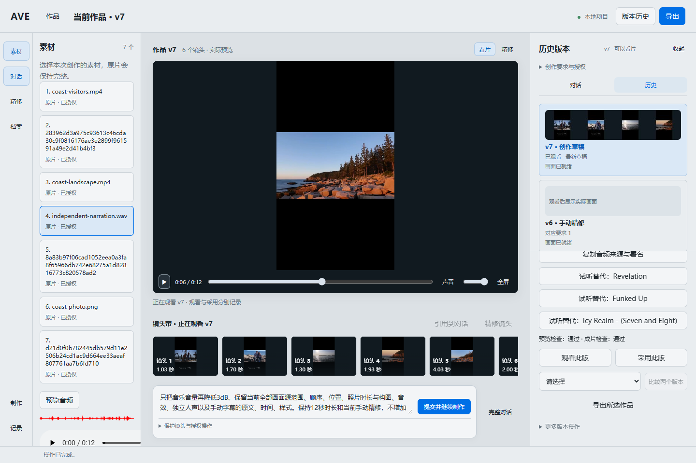

# AVE · AI Vlog Co-Editor

Target: automatic editing comparable to Hypit/ChatCut, with fine editing on the same versioned work. All four model roles use cloud configuration; cloud rendering is permitted and local deployment work is deferred. Remote rendering is not implemented by the current container. See [ADR-0059](docs/decisions/ADR-0059-cloud-editing-direction.md).

Turn your footage and a conversation into a versioned Vlog draft. Review the cut, ask for changes, and export the finished video from your browser.

[English](README.md) · [简体中文](README.zh-CN.md) · [Docker quick start](#docker-quick-start) · [Documentation](docs/README.md) · [Report an issue](https://github.com/tealigantal/AVE/issues)

[](https://github.com/tealigantal/AVE/actions/workflows/ci.yml)



*Build-specific screenshot retained with the mixed-media P5 Evidence assets; it is not a fresh screenshot of the current checkout or proof that P4/P5 acceptance is complete.*

## What you can do

- **Start with mixed media and intent.** Import video, JPEG/PNG/WebP photos and WAV/MP3/M4A/FLAC audio into one work. Describe the film you want and create a draft.
- **Choose music and refine the cut.** Explicitly enable the 40-track / 80-effect free audio pack for automatic music; search, audition and add or replace sounds manually. Basic timeline, picture, audio and caption refinements stay in the version history. Used audio is saved with source and license details; unused audition cache can be cleared.
- **Revise and retain history.** Keep versioned edits and continue saved projects after restarting the local runtime.
- **Review before exporting.** Play the Preview and download the Master, with separate rendering and QC checks.
- **Control external analysis.** Review exactly which material and context may be sent to configured cloud models.
- **Run AVE in the Docker Browser Host.** Docker Compose is the active user workflow documented here. The repository also contains an Electron runtime with a distinct IPC transport; Electron-only results do not establish Browser-host behavior.

AVE remains under active development. P4 was completed on its recorded build; two P4 interaction records require revalidation against the changed code. P5 current-build end-to-end acceptance is blocked and has not passed. Follow [generated current status](docs/current/STATUS.md) and [current work](docs/current/WORK.md) for live programme state; historical screenshots and old acceptance runs do not prove P5 acceptance. Human aesthetic and listening feedback are optional. See the [P4/P5 execution plan](docs/plans/2026-10-03-reliable-workbench-real-acceptance.md) and [known gaps](docs/current/DEBT.md).

## Docker quick start

This is the user-facing Compose Browser Host workflow. Its Browser entry and HTTP transport differ from the separate Electron runtime; Project Host remains the single project-state authority.

### 1. Get the repository

```sh
git clone https://github.com/tealigantal/AVE.git
cd AVE
```

Install and start [Docker Desktop](https://docs.docker.com/desktop/setup/install/windows-install/). On Windows, select **Linux containers**. Work from Windows PowerShell and your browser; no Ubuntu desktop or separate Node/Python/FFmpeg installation is needed.

### 2. Configure your models once

In PowerShell:

```powershell
Copy-Item .env.example .env
notepad .env
```

On macOS/Linux use `cp .env.example .env` and your editor. Fill both keys:

```dotenv
AVE_VISION_API_KEY=your-vision-key
AVE_PLANNER_API_KEY=your-planner-key
COMPOSE_FILE=compose.yaml|docker/compose.cloud.yaml|docker/compose.cloud.profiles.yaml
COMPOSE_PATH_SEPARATOR=|
```

This selects cloud-only model profiles without local Whisper/YAMNet. Cloud calls need network access and may incur provider charges. Keep `.env` private. Existing 6084/6085 instances must retain their project names, port files, volumes and settings; these fresh-install instructions must not replace an existing instance.

### 3. Start AVE

```sh
docker compose up
```

The generic fresh-install entry is **[http://localhost:6080](http://localhost:6080)**. Existing evaluation entries are 6085 (cloud-only models) and 6084 (retained mixed configuration). First startup still builds the Host/Worker/FFmpeg image. Model calls are remote; rendering remains in the container.

The cloud-only configuration starts `desktop` only. It does not establish complete-video acceptance or cloud rendering.

For background operation:

```sh
docker compose up -d --wait --wait-timeout 1800
```

## Your first film

1. Create a project and upload video/audio through the workbench.
2. Describe your goal, review the exact external-analysis authorization, and start creation.
3. Watch the preview, request revisions, and download the exported Master when satisfied.

After an import failure, open **Issues and recovery** to inspect the cause and retry only failed items; dismissing a brief notification does not remove the issue. When an asset has more than one original source, choose the specific original in the creation authorization. An older authorization without an unambiguous original requires a new request and source selection.

A version-history preview only watches that version; choose **Adopt** to commit it. In the browser, “download started” does not confirm that the file was saved: check the browser's download record and open the movie and any required attachments. Read any QC silence warning and check the actual output; QC can miss short gaps or a missing audio track masked by another track.

In **Profile**, you can review the authorized learning scope, query a listed context, exclude an experience for the current query, and explicitly correct or forget selected experience. Context names currently match exactly, so choose the listed context rather than relying on similar wording. Sending profile principles to a model requires that data in the creation request's authorization. The forget confirmation shows affected experiences and dependent corrections before removal; project versions remain available.

Closing the browser does not stop Docker. Projects and uploaded media remain in persistent volumes.

## Data and everyday commands

| Data | Storage |
| --- | --- |
| Projects and SQLite | `ave-desktop_projects` Docker volume |
| Uploaded source media | `ave-desktop_uploads` Docker volume |
| User profile / recent projects | `ave-desktop_profile` Docker volume |
| Whisper cache | `ave-desktop_whisper-models` Docker volume |
| Private runtime configuration | `ave-desktop_configuration` Docker volume |
| Optional mounted sources | `./materials`, read-only |
| Exported videos | `./exports`, plus browser download |

Set `AVE_MATERIALS` / `AVE_EXPORTS` in `.env` to change host directories. Existing Windows configurations may use `%LOCALAPPDATA%/AVE/docker/`. Native projects are not automatically migrated. Keep projects on a Docker volume rather than a Windows bind directory: Host requires Linux file-permission semantics.

```sh
# Stop; retain projects, uploads, exports and caches
docker compose down

# Rebuild after pulling updates; retain data
docker compose up -d --build --wait --wait-timeout 1800

# Inspect startup and failures
docker compose ps
docker compose logs --tail=100 desktop
```

After changing model keys/settings, use `docker compose up -d --force-recreate --wait --wait-timeout 1800`. Use `docker compose down -v` only when you intend to delete persistent data. Check logs for private information before posting them publicly.

Startup troubleshooting: Docker Desktop must be running, cloud credentials configured and the selected instance port free. Configuration, download and model failures are reported explicitly. See the [Docker guide](docs/04-engineering/DOCKER_DESKTOP.md).

## How AVE works

The browser sends typed requests to **Project Host**, the sole project-state and SQLite write authority. Models propose candidates; Host validates and commits edits. A committed Timeline produces one Semantic Render Manifest, separate Preview/Master RenderGraphs and execution plans; Worker/FFmpeg renders and QC checks outputs.

| Area | Source |
| --- | --- |
| Browser adapter / workbench | `apps/web/`, `apps/desktop/src/renderer/` |
| Project authority / persistence | `packages/platform/project-host/`, `packages/platform/project-storage/` |
| Media execution | `apps/worker-host/` |
| Typed protocols | `contracts/` |
| Container packaging | `compose.yaml`, `docker/` |

See [architecture](docs/architecture/SYSTEM_ARCHITECTURE.md), [product scope](docs/product/EDITING_CAPABILITY_SCOPE_V1.md) and [roadmap](docs/product-intelligence/STAGE3_PLAN.md). Planned, implemented and accepted capabilities are distinguished.

## Development and contribution

For source development use Node.js 22, pnpm 11.9.0 and Python/media tools described in the [engineering guide](docs/04-engineering/README.md). Use an isolated Python environment with the [pinned Worker dependencies](apps/worker-host/requirements.txt); the checks require Pillow 12.3.0. Activate it before running the commands below.

```sh
pnpm install --frozen-lockfile
pnpm run check
pnpm run acceptance:final:synthetic
```

Start with [AGENTS.md](AGENTS.md), [documentation home](docs/README.md), [document index](docs/DOCUMENT_INDEX.md) and the relevant domain authority. The [current status](docs/current/STATUS.md) is generated: edit its sources, then run `pnpm run docs:sync` and `pnpm run docs:check`.

Bug reports and focused PRs are welcome. Include reproduction steps, OS/device, relevant errors and expected behavior; remove API keys and private media. Consult [current work](docs/current/WORK.md) before expanding scope. Automated verification, real-media evidence and human acceptance are reported separately.

## License

This repository currently has no declared project license. Public source availability does not itself grant an open-source license; clarify permission with the maintainer before redistribution or reuse.
