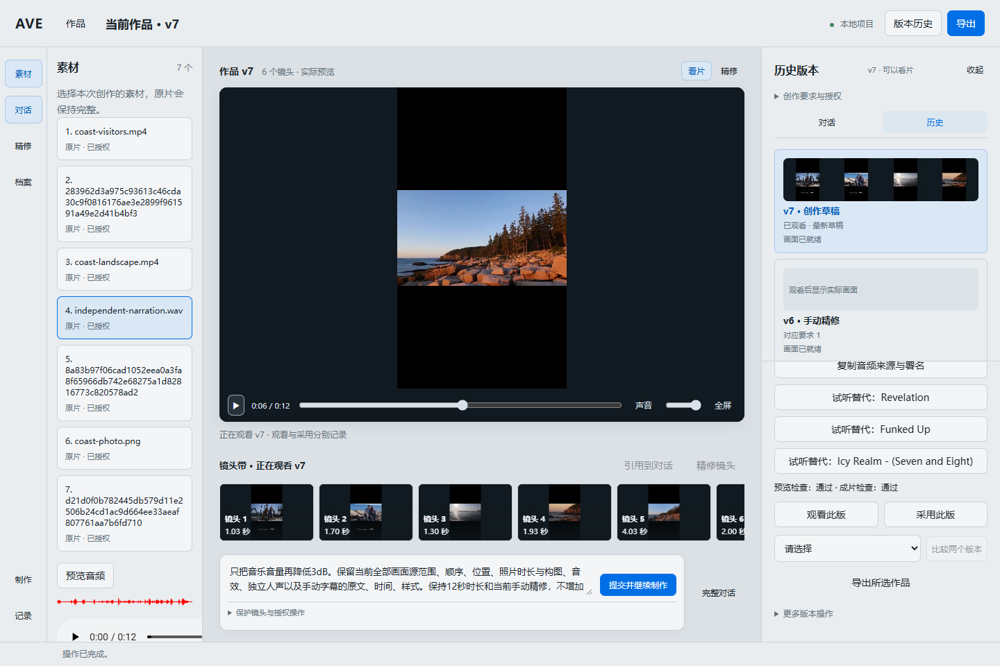

# AVE · AI Vlog Co-Editor

当前目标：自动剪辑效果对标 Hypit/ChatCut，并可在同一作品上精修；四类模型全部云端配置，允许云端渲染，本地部署暂缓。现有容器仍执行 FFmpeg，云端渲染尚未接入。见 [ADR-0059](docs/decisions/ADR-0059-cloud-editing-direction.md)。

把你的素材和一段对话变成有版本记录的 Vlog 初稿。在浏览器里看作品、提出修改，再导出成片。

[English](README.md) · [简体中文](README.zh-CN.md) · [Docker quick start](#docker-quick-start) · [项目文档](docs/README.md) · [反馈问题](https://github.com/tealigantal/AVE/issues)

[](https://github.com/tealigantal/AVE/actions/workflows/ci.yml)



*Historical screenshot artifact from the mixed-media P5 Evidence bundle; it is not a fresh screenshot of the current checkout or proof that P4/P5 acceptance is complete.*

## 可以做什么

- **从混合素材和目标开始。** 同一作品可导入视频、JPEG/PNG/WebP 图片与 WAV/MP3/M4A/FLAC 纯音频，再通过对话生成初稿。
- **选配乐并精修。** 显式启用 40 首配乐、80 个音效的免费资源包后自动选曲；也可搜索、试听、添加或替换声音。时间线、构图、音频和字幕基础精修进入版本历史。已用音频连同来源与许可保存在项目中，未用试听缓存可清理。
- **修改并保留历史。** 编辑结果有版本记录，本地运行环境重启后可以继续已有项目。
- **先看作品，再交片。** 播放 Preview 预览，下载经独立渲染和 QC 检查的 Master 成片。
- **掌控外部分析授权。** 审核哪些素材与上下文可以发送到配置的云端模型。
- **浏览器工作台。** 当前评估使用 Compose Browser Host；Electron 为保留路径，不是本轮建设目标。

AVE 仍在积极开发中。P4 已在其记录的构建上完成；代码变更后，两项 P4 交互记录需要重新验证。P5 当前构建端到端验收受阻，尚未通过；实时状态见[当前状态](docs/current/STATUS.md)和[当前工作](docs/current/WORK.md)。历史截图和测试记录不代表 P5 已通过，人工审美与听感反馈为可选项。

## Docker quick start

本节描述现有全云模型容器评估入口；云端渲染为目标能力，尚未接入。

### 1. 获取仓库

```sh
git clone https://github.com/tealigantal/AVE.git
cd AVE
```

安装并启动 Docker Desktop。Windows 使用 **Linux containers** 模式。直接在 Windows PowerShell 和浏览器中操作，无需 Ubuntu 桌面，也无需单独安装 Node、Python 或 FFmpeg。

### 2. 首次配置模型

在 PowerShell 中执行：

```powershell
Copy-Item .env.example .env
notepad .env
```

macOS/Linux 使用 `cp .env.example .env`，再用自己的编辑器打开。填写两个 Key：

```dotenv
AVE_VISION_API_KEY=你的视觉模型密钥
AVE_PLANNER_API_KEY=你的规划模型密钥
COMPOSE_FILE=compose.yaml|docker/compose.cloud.yaml|docker/compose.cloud.profiles.yaml
COMPOSE_PATH_SEPARATOR=|
```

上述配置选择全云端模型，不启动本地 Whisper/YAMNet。云端调用需要网络并可能收费，请保密 `.env`。已有 6084/6085 实例须保留各自项目名、端口、卷和配置，不套用新安装指令重建。

### 3. 启动 AVE

```sh
docker compose up
```

新安装通用入口为 **[http://localhost:6080](http://localhost:6080)**；现有评估入口为 6085（全云模型）与 6084（保留混合配置）。首次仍需构建 Host/Worker/FFmpeg 镜像；模型调用在云端，渲染仍在容器中。

全云模型入口只启动 `desktop`，不代表完整视频验收通过或云端渲染已经实现。

后台运行：

```sh
docker compose up -d --wait --wait-timeout 1800
```

## 制作第一部作品

1. 在工作台创建项目，上传视频或音频。
2. 描述目标，审核具体的外部分析授权，再开始创作。
3. 观看预览、提出修改，满意后下载导出的 Master 成片。

导入失败后可在“问题与恢复”中查看根因并只重试失败项；关闭短暂提示不会删除问题记录。同一素材有多个原片来源时，需要在创作授权中选择具体来源；历史授权没有绑定且来源不唯一时，应新建请求并选择来源。

版本历史中的预览只用于观看，选择采用后才会提交该版本。浏览器显示“下载已发起”不代表文件已保存：请在浏览器下载记录中确认，并打开成片及所需附件。留意 QC 的静音提示并检查实际输出；较短的缺音或被其他音轨掩盖的缺失可能不会被 QC 检出。

在“档案”中可核对学习授权范围、按列出的情境查询、为本次查询排除某项经验，并显式纠正或遗忘经验。当前情境名称按精确文本匹配，请选择列表中的名称；向模型发送个性化原则还需要在创作请求中授权。遗忘前的确认窗口会列出受影响的经验及依赖纠正，项目版本仍保留。

关闭浏览器不会停止 Docker。项目与上传素材保存在持久卷中。

## 数据与日常操作

| 数据 | 存放位置 |
| --- | --- |
| 项目与 SQLite | `ave-desktop_projects` Docker 卷 |
| 上传的原始素材 | `ave-desktop_uploads` Docker 卷 |
| 用户档案、最近项目 | `ave-desktop_profile` Docker 卷 |
| Whisper 缓存 | `ave-desktop_whisper-models` Docker 卷 |
| 私有运行配置 | `ave-desktop_configuration` Docker 卷 |
| 可选素材挂载目录 | `./materials`，只读 |
| 导出视频 | `./exports`，同时支持浏览器下载 |

`.env` 中的 `AVE_MATERIALS`、`AVE_EXPORTS` 可指定其他宿主机目录。已有 Windows 配置可能使用 `%LOCALAPPDATA%/AVE/docker/`。原生项目不自动迁移。项目保留在 Docker 卷中，不要改成 Windows 绑定目录；Host 依赖 Linux 文件权限语义。

```sh
# 停止服务，保留项目、上传、导出与缓存
docker compose down

# 拉取更新后重建，保留数据
docker compose up -d --build --wait --wait-timeout 1800

# 查看状态和启动错误
docker compose ps
docker compose logs --tail=100 desktop
```

修改模型密钥或设置后，用 `docker compose up -d --force-recreate --wait --wait-timeout 1800` 加载配置。只有明确要删除持久数据时才用 `docker compose down -v`。公开反馈日志前检查私有信息。

启动失败时，检查 Docker Desktop 是否运行、两个密钥是否填写、6080 端口是否空闲、所选显卡是否可用。配置、下载和模型错误都会明确报告。详见 [Docker quick start](#docker-quick-start)。

## 工作原理

浏览器向 **Project Host** 发送类型明确的请求；Host 是项目状态与 SQLite 写入的唯一权威。模型只提出候选，Host 校验后提交剪辑。已提交 Timeline 派生一份 Semantic Render Manifest、独立的 Preview/Master RenderGraph 与 ExecutionPlan，再由 Worker/FFmpeg 渲染并进行 QC。

| 模块 | 源码位置 |
| --- | --- |
| 浏览器适配与工作台 | `apps/web/`、`apps/desktop/src/renderer/` |
| 项目权威与持久化 | `packages/platform/project-host/`、`packages/platform/project-storage/` |
| 媒体执行 | `apps/worker-host/` |
| 类型协议 | `contracts/` |
| 容器打包 | `compose.yaml`、`docker/` |

进一步阅读[系统架构](docs/architecture/SYSTEM_ARCHITECTURE.md)、[产品范围](docs/product/EDITING_CAPABILITY_SCOPE_V1.md)和[路线图](docs/product-intelligence/STAGE3_PLAN.md)。规划、已实现与已接受能力分开记录。

## 开发与贡献

源码开发使用 Node.js 22、pnpm 11.9.0，以及[工程指南](docs/04-engineering/README.md)要求的 Python 和媒体工具。使用安装了[固定 Worker 依赖](apps/worker-host/requirements.txt)的隔离 Python 环境；检查要求 Pillow 12.3.0。先激活该环境，再执行下面的命令。

```sh
pnpm install --frozen-lockfile
pnpm run check
pnpm run acceptance:final:synthetic
```

从 [AGENTS.md](AGENTS.md)、[文档首页](docs/README.md)、[文档索引](docs/DOCUMENT_INDEX.md)和对应领域权威文档开始。当前状态由工具生成；修改来源后执行 `pnpm run docs:sync`、`pnpm run docs:check`。

欢迎提交问题和聚焦的 PR。请附复现步骤、系统与设备、相关错误和期望行为，移除 API Key 与私有素材。扩展范围前查阅[当前工作](docs/current/WORK.md)。自动验证、真实素材证据与人工接受分开报告。

## 许可证

仓库目前尚未声明项目许可证。源码公开不等于授予开源许可；再分发或复用前请向维护者确认授权。
